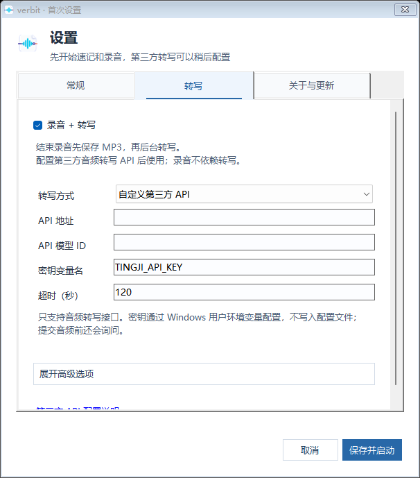

# verbit


Windows 上随手记录想法、保存会议声音的小工具。用全局快捷键打开原生置顶便签，或用一个小浮窗控制双路录音；默认仅录音，结束得到 **一条 192 kbps MP3**。开启转写后再生成一份 Markdown。支持普通文件夹和 Obsidian，速记与录音不依赖模型，首期转写仅选配第三方 API，已有本地环境保留兼容。

[下载 Windows x64 安装版](https://github.com/Qjzn/verbit/releases/tag/v0.1.0-beta.2) · [安装与快速上手](documentation/install-windows.md) · [配置说明](documentation/configuration.md) · [交给 AI 安装](documentation/ai-install.md)

- **随手记**：`Ctrl+Alt+J` 打开置顶便签，中文输入、粘贴图片，停顿后自动保存。
- **轻量开会**：小浮窗控制麦克风和电脑声音，支持暂停、重点时间标记及默认 5 秒误触保护。
- **文件自己留**：默认保存 MP3；开启转写并校验成功后，保留 MP3 和 Markdown，清理临时音轨。新 API 模式仅录音校验 MP3 后也会清理临时分轨；处理失败保留恢复资料，已有本地模式保留无损工作流。

准备参与开发或审查？从 [架构与边界](documentation/architecture.md)、[测试覆盖](documentation/tests.md) 和 [开源检查](documentation/open-source-readiness.md) 开始。

安装包的新用户路径、空环境依赖与实际转写结果见 [新用户验证](documentation/new-user-validation.md)；未测项目单独标记，不用自检通过代替真实使用。

## 界面预览

186×68 逻辑像素的录音浮窗，麦克风可单独关闭，电脑声音继续收录：


原生速记支持图片、置顶和自动保存；设置可修改保存目录与快捷键：

本轮 `0.1.0-beta.11` 私有候选聚焦速记和录音，**不提供推荐模型下载或安装选项**。无需 Python、模型、FFmpeg 或开发环境即可录音，192 kbps MP3 在结束后原生生成并完整解码校验。可在设置中主动启用第三方音频转写 API，填写自己的地址、模型 ID 和密钥环境变量名；确认上传后才提交，不调用普通聊天接口。已有模型与配置保留，升级不下载、不删除或自动切换。候选尚未公开发布，详见[版本说明](documentation/changelog.md)。

 

截图来自当前版本的原生窗口，文字、图片和音量数据为专用演示内容，不包含真实会议或个人路径；录音状态图用于展示界面，不作为硬件或转写质量证据。

## 安装版快速上手

1. 在 [Releases](https://github.com/Qjzn/verbit/releases/tag/v0.1.0-beta.2) 下载 EXE 并核对随包 SHA256。需要 **Windows 10 1809+ / Windows 11 x64、.NET Framework 4.8**，无需管理员权限。
2. 安装后首次弹出设置，选择保存目录、确认快捷键，点击「保存并启动」。取消不创建配置，下次仍可设置；已有配置不会被覆盖。
3. 程序驻留托盘，按 **`Ctrl+Alt+J`** 打开置顶速记，直接输入或粘贴图片，停顿后自动保存。
4. 按 **`Ctrl+Alt+L`** 开始/结束录音；默认只得到一条 MP3。新安装保存到 `<保存目录>/verbit/verbit年月日时分/verbit年月日时分.mp3`，如 `verbit202610271430`；同分钟重录自动加 `-02`、`-03`，不覆盖旧文件。设置了自定义会议子目录时，保留你的子目录。
5. 需要转写时，打开「设置 → 转写」，勾选“录音 + 转写”，配置支持 `/audio/transcriptions` 的第三方模型。结束时先保存 MP3，再明确确认是否上传；也可仅录音后，从最近会议手动转写。成功后 Markdown 与 MP3 同目录同名；接口错误、超时、空结果、无效时间轴或文件冲突保留恢复资料及原因。完整配置见[安装说明](documentation/install-windows.md#启用会议转写)。

当前版本是 `0.1.0-beta.2` 预发布版，仓库仍私有；下载需要仓库权限。录音质量、设备兼容及干净机器安装的实际覆盖范围见 [质量证据](documentation/quality.md)、[发布验收](documentation/release-readiness.md) 和 [开源准备检查](documentation/open-source-readiness.md)。首期不推荐本地模型；第三方接口的速度、准确率、文件大小上限与费用由服务商决定。

## 会议操作

浮窗顶部为中间独立 Logo 与小写名称 **verbit**、右上隐藏；没有返回按钮。待机时提供速记、录制和设置三个图标，悬停显示介绍和当前快捷键。关闭只隐藏浮窗，录音和后台转写继续；结束会议请点击红色方块或使用开始/结束快捷键。录制时使用无损分段，结束后合并为一条校验后的 MP3。新 API 流程直接提交该 MP3；已有本地模式继续从无损音轨转写。

浮窗或托盘右键 → **设置…** 可修改保存目录、会议/速记子文件夹及四组快捷键。结束录音并等待转写后修改；保存会先安全关闭已保存的速记，再验证快捷键并写入配置，成功后立即生效。快捷键被占用或配置被外部修改时留在设置窗口显示原因。新地址用于后续内容，已有文件留在原位置。

转录时间戳可通过本机 `pianyan://` 协议定位回听：先运行 `Register-Playback.ps1`（或安装运行环境时加 `-EnablePlaybackLinks`），播放器打开后停在指定位置，按播放才发声；未启用协议时从最近会议 → 回听录音手动定位。旧笔记不批量改写。

会议控制使用托盘和 **186×68 逻辑像素的置顶浮窗**：左侧计时与录音输入波形，中间麦克风开关与输入反馈，右侧纯红方块结束。顶部为 Logo 与名称、关闭浮窗。正常录音时不显示「录音中」文字；任一路有实际声音时左侧波形跳动，安静时回落。关闭麦克风用划线图标表示，电脑声音继续录制；计时不中断。关闭浮窗后继续录音，双击托盘恢复。折角纸页与声波图标表示就绪，红色状态点表示录音。

输入波形平滑变化，按钮状态使用约 120–180 毫秒的短过渡。`animation_mode` 默认 `"auto"`，跟随 Windows 客户区动画及高对比设置；`"on"` 只为 verbit 开启动效，适合系统关闭动画但希望 verbit 保留动效的情况；`"off"` 关闭非必要动画。三种模式都不修改 Windows 设置，波形只反映真实输入，安静时不制造音量跳动。

| 操作 | 默认方式 | 效果 |
| --- | --- | --- |
| 开始 / 结束会议 | `Ctrl+Alt+L` | 同时收录麦克风与电脑声音；默认结束后保存 MP3。开启“录音 + 转写”才自动转写，缺少环境时提示配置。 |
| 暂停 / 继续麦克风 | `Alt+Space`，按一次切换 | 只暂停麦克风，再按恢复；电脑声音持续录制、计时不中断。与浮窗麦克风按钮共用状态，只在录音期间占用此快捷键。 |
| 标记重点时间 | `Ctrl+Alt+K` | 录音中记下当前会议时间，转录中生成「重点时刻」；也可从托盘或浮窗右键操作。 |
| 展开 / 收起速记便签 | `Ctrl+Alt+J` | 恢复上次便签，收起前保存；左上角「＋」或正文内 `Ctrl+N` 新建，不改变录音状态。 |
| 关闭 / 开启麦克风 | 点击浮窗麦克风 | 只影响 verbit 的收录，电脑声音继续录制；不改变会议软件的通话。 |
| 隐藏 / 展开浮窗 | 右上角关闭 / 双击托盘 | 录音持续进行。 |
| 查看处理结果 / 重试 | 托盘「最近会议」 | 按会议时间选择对应笔记、录音资料或失败重试；新 API 流程复用已完成结果；已有笔记发生修改时拒绝覆盖。 |
| 会后快速命名 | 所选已完成会议的「命名这场会议」 | 在小输入框填写标题，修改 Markdown 文件名及会议标题；不改动录音，重名不覆盖。 |

速记采用单行顶部：左侧新建，中间 Logo 与当前文件名，右侧置顶、最小化和关闭；文字与图标垂直居中。鼠标离开窗口约 300 毫秒后，顶部、底部和左侧标签收起，正文收回上下空间，仅留正常内边距；移入重新显示，窗口尺寸不变，保留选区、焦点及有效滚动位置。右键菜单、图片拖拽及保存异常期间保留必要控件和提示。标签完整名称优先显示在正文外侧；屏幕边缘没有安全空间时不弹遮挡提示，可从「更多」按文件名查找。

选中图片后，拖动四角按当前显示比例放大、缩小；拖动左右边缘只调整宽度，上下边缘只调整高度。使用轻量轮廓预览，松开后整步应用，可撤销。右键提供适合窗口、等比例放大/缩小、恢复原图比例及查看原图；双击图片也可用系统查看器打开原图。尺寸随 Markdown 保存，重开保留，原图像素不改动；自由尺寸使用 `` 或 wiki 图片的 `|240x160`。显示边长上限 2000 逻辑像素，超过 100:1 的极端长宽比保留可编辑图片引用；图片撤销缓存到达既有上限时提示保存重开。常规长截图仍按比例预览。

四个快捷键均可通过 `hotkey`、`pause_hotkey`、`bookmark_hotkey`、`quick_note_hotkey` 自定义，不能相互冲突；暂停和标记快捷键仅在录音时注册。辅助快捷键被占用时会指出对应键，录音仍能开始，可从右键菜单操作。浮窗空白处或录音按钮右键可打开与托盘相同的操作菜单；结果路径的右键仍用于复制完整路径。

默认有 **5 秒误触保护**：结束时有效录音不足 5 秒，清理本场临时录音，不保存 MP3 或 Markdown，也不启动本地/API 转写；满 5 秒正常保留。暂停麦克风仍计入保护时间，因为电脑声音继续收录。可从右键菜单「设置… → 录音保护（秒）」修改，或在配置中设置 `recording_protection_seconds`；允许整数 `0`–`300`，`0` 关闭，修改用于之后开始的会议。

## 速记便签

纸贴标签和「更多便签」列表均可右键选择「删除便签…」，确认后移入 Windows 回收站；删除当前便签会先保存输入并切换到剩余便签，删除最后一篇则打开新的空白便签。图片附件保留，避免删除其他便签共用的图片。有未处理恢复草稿、外部修改或保存失败时阻止删除。若 Windows 提示无法回收而需永久删除，请选取消以保留文件。

`Ctrl+Alt+J` 展开或收起 verbit 内置便签，也可从托盘「速记便签」打开；原有 `Ctrl+Alt+L` 录音操作不变。速记快捷键被占用时会提示，仍可从托盘打开，不妨碍录音。便签使用 Windows 原生 RichEdit，不加载 WPF 或浏览器；默认置顶，初始尺寸为 360×420 逻辑像素，可调整大小。`Esc`、关闭按钮均收起便签。窗口位置、尺寸等本机设置不写入笔记库。

便签保存在 `vault_root/速记/`，可用 `quick_note_folder` 改目录。首次没有历史状态时沿用 `yyyy-MM-dd.md`；之后恢复上次文件，不跨天强制切换。左上角「＋」或正文内 `Ctrl+N` 新建独立的「便签 日期 时间-唯一后缀.md」，未输入的空白便签不生成文件。顶部仅显示 Logo 和文件名，右侧依次是置顶、最小化、关闭；各文件分别恢复光标、选区和滚动位置。

鼠标进入正文区域时显示外侧纸贴标签，数量按高度调整（最多 5 个）。窗口贴左边时标签自动移到右侧，两侧都放不下就隐藏纸贴，通过顶部文件名切换，不覆盖或挤动正文。「更多」和顶部文件名打开可搜索、可滚动的最近便签列表（最多 50 个）；方向键选择、回车打开、Esc 关闭。移出窗口后收起，移回会恢复正在收起的标签。停留约 250 毫秒预览对应文件，点击标签才正式切换；移回正文恢复原编辑内容。预览是独立只读覆盖层，不切换编辑焦点，开始输入前先退出预览；只显示前 12,000 个字符，图片保留引用，不解码原图、不保存或修改便签。右下角文档菜单可关闭「悬停标签预览内容」。细滚动条保留原生滚轮，悬停加宽；标签动画只在过渡期间运行。多文件视图记录与预览偏好保存在库外，本轮没有新增配置键。

底部工具栏支持加粗、斜体、下划线、删除线、项目符号和插入图片；文字直接呈现格式，按钮不会插入可见标记。选中文字后点击格式按钮可切换对应效果，没有选中文字时设置接下来输入的格式。`Ctrl+B` / `Ctrl+I` / `Ctrl+U` / `Ctrl+Shift+X` 分别应用前四种格式，`Ctrl+Shift+L` 切换选中行的项目符号。圆点列表中回车续写下一项，空项回车退出列表；Shift+Enter 仅换行。按钮悬停可看用途和快捷键，底部七个图标均匀排列；右下角文档图标悬停显示完整保存路径、点击打开保存与恢复菜单，正常输入和自动保存不显示闪烁状态行。仍只保存 Markdown，富文本格式使用内联 HTML 标签，列表使用 `- `；不新增 RTF 附件。重开时原生呈现支持的格式；代码中的标记和未闭合标签保留原文。未编辑的旧文档保留原始 Markdown，编辑后可规范化格式标签写法；不同阅读器对内联 HTML 的支持有所区别。可粘贴截图，或粘贴/拖入可解码的本地图片文件；图片转为 PNG，保存到 `速记/图片/<内容哈希>.png`，正文使用相对 Markdown 引用，同一图片内容复用文件。单个源文件及转换后 PNG 均不超过 12 MiB，像素不超过 3600 万，多帧图片只取首帧。普通文件夹与 Obsidian 都可使用，不依赖 QuickAdd 或 Obsidian 浮窗。

编辑停顿 500 毫秒后，后台依次保存恢复草稿和正文，慢盘保存期间仍可继续输入和拖动；新输入合并为最新待存版本。收起和退出会等待最新内容保存完成，不阻塞界面等待。发现笔记被外部修改或删除时提示冲突，不覆盖外部内容；点击底部提示可打开速记文件夹、复制当前内容、查看草稿，或保留草稿后载入磁盘版本。草稿也无法落盘时，内容仍留在窗口，应先复制保存。保存失败或输入法组合尚未提交时，保留编辑器并取消本次退出，不会先停止录音。更新程序时一并保留库外的 `work/`。

图片粘贴只读取用户发起的这一次粘贴，不主动写入、清空或备份恢复系统剪贴板；只有主动复制或剪切才会更新剪贴板。图片编码与落盘在后台完成，处理期间可继续输入；图片准备完成时若仍在输入法选词，会等组合结束后再插入，保留期间的新文字和光标，撤销可取消等待中的图片。最多同时排队 16 项，剪贴板图片的待处理像素总量不超过 3600 万。标题栏使用系统拖动，遵循 Windows 的窗口拖动设置，不修改全局设置。回归测试使用内存图片与独立测试桌面，不读写真实剪贴板、不向当前窗口注入按键。

输入和中文组合由原生编辑器处理；输入期间只标记修改，停顿后才生成 Markdown 保存快照。普通 `Enter` 一次换一行，保留当前笔记的 LF/CRLF 换行格式，无需配置行距或换行开关。图片仍以 Markdown 引用保存，撤销、恢复草稿及外部修改保护保留，无需新增依赖或配置字段。参考 NoteFly 的原生编辑器架构进行对照，未复制其 GPL 代码。独立 Win32 与不加载 WPF 的 RichEdit 对照已由用户确认输入和拖动流畅；正式入口与后续修复的验证证据见[质量说明](documentation/quality.md)。

图片较多时可改以 Markdown 引用显示，原图与引用不丢失。超大正文或少见控制字符无法安全载入时保留原文件并提示，不会另存空白覆盖。具体边界见[配置说明](documentation/configuration.md#速记保存与恢复)。

若曾安装独立的 `ObsidianQuickNoteHotkey.exe`，先停用它及其「Obsidian 速记快捷键」登录启动项，避免占用同一组合；保留既有速记笔记，不用历史 QuickAdd 备份覆盖现有配置。

浮窗尺寸为 **186×68 逻辑像素**，随 Windows 缩放，使用原生高 DPI 支持避免整体位图放大。构建会嵌入 `app.manifest`，并生成配套的 `ObsidianMeeting.exe.config`；更新时须一起保留，不能只复制 EXE。

默认跟随 Windows 默认麦克风，并收录**所有活动播放设备**的电脑声音，覆盖会议软件与媒体被分配到不同设备的情况。已有活动输出在默认设备切换前就开始捕获；麦克风默认设备变化时切换到新输入，保持麦克风开关状态。新增或重新启用的设备需要初始化，不能承诺初始化前的声音也已录下。也可通过 `system_capture_mode: "default"` 只跟随默认播放设备，或用设备 ID 固定输入/输出。悬停查看设备与输入状态；`notify_device_changes: false` 只关闭变化提醒，不关闭跟随。麦克风暂停区间仅该轨保留静音，电脑声音持续，重点标记和转录使用同一会议时间轴。

采集直接使用 WASAPI 包的设备位置和 QPC 时间戳，以共同时间轴写入各轨，不再把回调迟到当成新静音。连续设备帧保持相位连续，用较长窗口轻量校时，避免将短期时间戳抖动变成静音洞；停止时排空边界前数据。时间戳异常或数据中断会保留诊断，不用相同 WAV 长度冒充同步成功。受保护、独占音频和设备故障仍可能无法录制，实际设备与长会议验证范围见[质量说明](documentation/quality.md)。

两路持续无声默认满 60 秒提醒一次，帮助发现忘记播放或选错设备；有声音恢复后才重新计时。关闭麦克风时只根据仍在录制的电脑声音判断。`silence_warning_seconds` 可设为 `0` 关闭。提醒是输入状态提示，不把安静认定为录音失败。

## 结束后与异常恢复

结束录音后，原有浮窗改为两行处理状态，隐藏麦克风和结束等录音按钮，仍可收起。等待动画表示后台正在处理；阶段名称和片段数只采用实际状态，动画不代表音频输入或整场百分比。托盘持续显示正在执行的阶段；已经取得片段总数时显示真实完成段数。开始下一场时浮窗与托盘优先显示当前录音，悬停可查看后台任务数量。

完成后小窗两行分别显示「录音：<相对路径>」「转录：<相对路径>」，直接展示实际保存位置。路径相对于配置的保存根目录，长路径优先省略目录，文件名仍过长时省略其中间部分并保留扩展名；悬停查看完整绝对路径，点击在资源管理器定位该文件，右键复制完整路径。托盘「最近会议」也可分别定位所选场次的 MP3 和 Markdown，旧会议仍可定位其 WAV。

托盘「最近会议」用精确到秒的会议时间标识各场状态，打开笔记、查看录音资料和重试都对应所选那一场。菜单最多显示 20 场，优先包含需要关注的记录；更早的本机资料可从 `work/` 查看。上一场失败后即使已经开始下一场，重试也不会改指向新录音。转写完成时，只有启用 Obsidian、允许自动打开且当前没有录音，才自动打开刚完成的笔记；录音中完成的会议从托盘手动打开，不切换当前前台窗口。

命名仅用于已完成且没有运行中转写进程的会议；正在录制另一场时入口禁用，避免弹窗打断。命名后历史显示「会议时间 · 标题」，Markdown 与其管理元数据保持一致；同名文件不会被覆盖，已有手写内容保留。重点时刻使用从本场开始起的墙钟时间，包含麦克风暂停时间，与录音、转录时间轴一致。

手动清理已成功完成的会议时，只删录音文件会显示「仅保留转录，录音文件已移除」，只删 Markdown 会显示「仅保留录音，转录文件已移除」；保留剩余文件的入口，不作为故障提醒，也不自动重试。两份都删除后，该场不再出现在最近会议中。采集、发布、校验或清理异常、路径不明、保存根目录不可用仍提示检查。程序保留内部状态文件，不自动删除或重建你的成品。

启动时检查本机 `work/` 中的会议状态。仍在运行的原转写进程会被接回，不重复启动；工具退出期间已完成的会议提供结果入口，失败的会议在存在原始录音时提供对应重试。需要关注的同一可读状态只提示一次；重试或状态改变后可以再提示。JSON 或路径异常无法安全记录提示状态时，每次启动仍会提醒检查。开启处理浮窗时用原小窗展示提示。中断录音只提供状态与资料检查入口，不能直接按普通失败任务重试；不自动继续录音、修复文件头、删除原资料或上传旧录音。文件是否可恢复需要先检查，不能保证任何中断都能完整找回。

三项反馈可通过 `show_processing_window`、`notify_device_changes`、`auto_open_completed_note` 控制，省略时均为 `true`。旧配置省略 `animation_mode` 时采用 `"auto"`，其他已确认字段保留原值。`show_processing_window: false` 不自动显示会后浮窗，结束时收起已有窗；仍可从托盘手动展开状态和结果，后续阶段刷新不会把手动展开的窗关闭。

## 交给 AI 安装

> 请按 documentation/ai-install.md 安装 verbit beta.11。使用 EXE，首次只设置保存目录和快捷键，默认仅录音，不安装 Python 或模型。保留已有模型、配置和会议；API 可按需填写服务地址、模型 ID 和密钥变量名，提交前单独确认上传。说明实测与未测部分，不默认修改开机启动，不操作用户剪贴板。

完整步骤见[AI 安装说明](documentation/ai-install.md)，字段见[配置说明](documentation/configuration.md)，首次模板见[config.example.json](src/config.example.json)。源码中的 Install.ps1 / RecommendedModel.ps1 等历史工具用于维护旧实验环境，不属于首期安装步骤。

## 源码目录

| 目录 | 内容 |
| --- | --- |
| `src/` | 控制器、转写、配置模板、依赖和安装/构建入口；源码安装在这里执行。 |
| `tests/` | 原生与 Python 回归，由 `src/Test.ps1` 启动。 |
| `documentation/` | 上手、配置、质量证据和开源检查。 |
| `packaging/` | EXE 打包、安装器和新用户流程验证。 |
| `assets/` | 当前 Logo 与演示截图。 |

安装后的程序保持独立运行目录结构，不包含测试代码；源码整理不改变已有安装的配置、保存路径与快捷键。

## 选择转写方式

| 模式 | 本机依赖和数据流 |
| --- | --- |
| 默认仅录音 | 不加载模型、不访问转写服务。结束后原生合并并校验一条 MP3。 |
| 可选第三方 API | 无 Python 或本地模型，确认后上传本场 MP3 到自定义 /audio/transcriptions。模型 ID、速度、费用、时长上限和身份能力由服务商决定。 |
| 已有 local 兼容 | 保留现有 Qwen / 说话人环境和配置，无损分轨转写，不推荐或自动下载模型。 |

API 需要兼容 multipart `POST /audio/transcriptions`，接受 MP3、`model`、`response_format=json`，可选术语 `prompt`。响应支持非空 `text` 或带 `start/end/text` 的 segments；服务实际返回 speaker/speaker_id 时才显示身份，不推断人名。普通聊天、Omni、URL 异步任务接口不能仅改模型名代替。配置和隐私边界见[安装说明](documentation/install-windows.md#启用会议转写)。

本轮没有真实服务质量背书。整条 MP3 单次提交，超过服务商文件限制会保留文件并说明 HTTP 错误；不会自动切块、换供应方或循环重传。超时可能已被服务商处理及计费，重试前应核对。已有本地模式的降噪、回声和跨轨身份候选不适用于新原生 API；默认均不会修改保存的 MP3。

## 文件与配置

```text
保存目录/
└─ verbit/
   └─ verbit202610271430/
      ├─ verbit202610271430.mp3
      └─ verbit202610271430.md   # 转写成功后才生成
```

采用录音开始时的本地年月日时分；同一分钟自动加 -02、-03，待导出的场次也占用名字。已有会议目录配置保留，新地址只影响后续内容，旧文件不迁移、不改名。

录制时每 300 秒切成原设备格式的无损段，同设备不重启、不重置时间轴。独立进程按共享时间轴混音，流式编码双声道 48 kHz MP3，不生成额外整场 WAV；默认 192 kbps（约 86.4 MB/小时），设置文件支持 128/192/256/320。临时分轨仍需要磁盘空间。

新 API 仅录音时，完整解码、长度和哈希校验 MP3 后清理本场临时音轨，稍后可由 MP3 转写。自动转写时成功校验 MP3 与 Markdown 后清理；采集异常、失败或篡改保留恢复资料。已有 local 模式保持无损输入工作流。程序 work 内的控制 JSON 是恢复元数据，不是重复录音附件，不要在任务进行中删除。

新 API 创建纯 Markdown，不添加录制时间、引擎模板或 HTML 管理标记。转写检查点留本机；已有笔记不同或输出被修改时拒绝覆盖。旧 Python 工作流仍保留手写区保护和原格式兼容。

## 开发验证与更新

源码位于 src，用户功能不依赖 Python。源码构建需要 .NET Framework 4.8 自带编译器和经过校验的 NAudio 1.10.0；恢复方式与 SHA256 见 [.github/workflows/ci.yml](https://github.com/Qjzn/verbit/blob/main/.github/workflows/ci.yml)，不能使用任意来历的 DLL。

```powershell
Set-Location .\src
# 先按 CI 的 Restore verified NAudio 步骤恢复 lib/NAudio.dll
powershell.exe -NoProfile -ExecutionPolicy Bypass -File .\Build.ps1
powershell.exe -NoProfile -ExecutionPolicy Bypass -File .\Restore-Encoder.ps1
.\ObsidianMeeting.exe
# 原生合同与 UI 回归，无真实采集、无外部上传
powershell.exe -NoProfile -ExecutionPolicy Bypass -File .\Test.ps1 -NativeOnly
```

Restore-Encoder 只准备固定版本 LAME 编码器及许可，不下载语音模型。首次运行仍通过设置选择保存目录；内部文件名 ObsidianMeeting.exe 为兼容旧快捷方式保留。Python 音频/旧转写合同测试是维护者额外依赖，不是用户依赖，见[测试说明](documentation/tests.md)。模型研究、候选声纹和旧 doctor 命令见[本地实验记录](documentation/local-model-evaluation.md)及[历史首次验收](documentation/first-use.md)。

测试使用隔离桌面、合成音频和本机 HTTP 模拟，不能证明真实麦克风/蓝牙切换、长会议、中文和说话人准确率或全新 Windows 安装已通过。真实采集、播放与 API 上传须提前获得同意。源码中的旧附件维护工具默认仅规划，不批量迁移旧会议。

升级前保存速记、结束会议、等处理完成，从托盘正常退出；安装到原目录。配置、模型、环境与既有录音保留；卸载也不会清除用户资料。设置 → 关于与更新可查看版本、GitHub 与版本说明；自动检查默认关闭，不自动安装更新。

## 许可与兼容

项目源码采用 [MIT 许可](LICENSE)。安装包附带的 NAudio 及自行安装的 Python 依赖、模型、FFmpeg 分别适用自身条款，见 [第三方说明](THIRD_PARTY_NOTICES.md)。项目公开前的隐私、许可和发布检查见 [开源准备检查](documentation/open-source-readiness.md)。

显示名称统一为小写 **verbit**；保留 `ObsidianMeeting.exe`、`tingji.py`、`TINGJI_API_KEY`、`pianyan://` 和既有状态格式以兼容原安装。英文名与现有同领域产品重名，当前仍为用户指定的项目名，公开发布前需另行确认名称，不以本项目的 MIT 许可说明名称可自由商用。

产品边界与后续小功能候选见 [产品范围](documentation/product-scope.md)。

维护者的本轮通过、失败与未测项见[录音先导出候选验收](documentation/recording-export-acceptance.md)；[集中设备复验](documentation/device-revalidation.md)只在参与者确认后运行，不进入日常安装流程。
