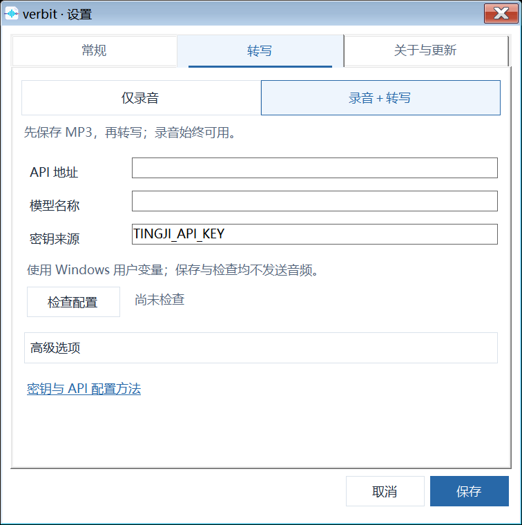

<p align="center"></p>

# verbit

**随手记下想法，安心留下会议。** Windows 上的轻量速记与会议录音工具。

默认仅录音，笔记与音频保存在本机。无需 Python、模型、GPU 或 Obsidian；需要文字时，再连接你选择的音频转写 API。

[下载安装包](https://github.com/Qjzn/verbit/releases/tag/v0.1.0-beta.38) · [五分钟上手](documentation/install-windows.md) · [配置说明](documentation/configuration.md) · [更新记录](documentation/changelog.md)

当前已发布版本：**0.1.0-beta.38 · Windows x64 测试版**。源码另有未发布的 beta.39 审查候选，区别见[更新记录](documentation/changelog.md)。仓库仍为私有，以上下载入口需要仓库访问权限；本轮不更改可见性。

## 能做什么

- **速记**：全局快捷键唤出原生便签，支持中文、常用格式、图片、置顶和自动保存。
- **会议录音**：同时收录麦克风与活动播放设备；可单独暂停麦克风，电脑声继续录制。
- **本地文件**：结束后生成一条 MP3；可选转写成功后再生成一份 Markdown，不绑定笔记平台。
- **恢复与重试**：处理失败保留恢复资料，不覆盖原笔记；可从最近会议检查具体原因。
- **可选 API**：由你提供服务地址与模型，上传前确认。没有配置 API 也能正常速记和录音。

## 为什么选择 verbit

适合想随手记事、保留会议原音，又不想先准备 AI 环境的 Windows 用户。

| 优势 | 日常怎么用 |
| --- | --- |
| 轻量安装、原生编辑 | 已发布基础安装包约 6 MB，使用 Windows 原生文本组件；速记和录音无需 Python、模型或 GPU。这里是安装体积，不是运行内存或所有设备的性能承诺。 |
| 随叫随写 | `Ctrl+Alt+J` 唤出上次便签，置顶输入、自动保存；「＋」可另建一张。 |
| 贴边标签切换 | 鼠标进入便签时显示最近标签，点击固定切换；可开启悬停预览，从「更多…」搜索最近最多 50 张便签。 |
| 文字和图片一起记 | 常用格式、圆点列表续写，粘贴截图、插入／拖入本地图片；图片可缩放并打开原图。 |
| 阅读大小随手调 | 正文内按住 `Ctrl` 滚动鼠标滚轮，放大／缩小显示；不改写 Markdown 正文的字号。 |
| 录音与 AI 分开 | 没有转写服务也可先留下 MP3；开关麦克风不打断电脑声，按需再配置音频转写 API。 |
| 文件由自己掌握 | 速记用 Markdown 和本地图片，会议用 MP3；不绑定 Obsidian、专用云盘或 verbit 账号。 |

verbit 的重点是便捷记录和可取走的文件。它没有内置会议总结模型，也不把未经人工核验的文字或说话人结果当作准确率优势。

## 界面预览

以下是 beta.38 原生窗口截图，使用演示文字和模拟输入电平，不包含真实会议或个人笔记；隔离桌面的系统标题栏可能与日常 Windows 主题不同。


<details><summary>查看设置与可选 API 配置</summary>




</details>

## 开始使用

1. 使用 Windows 10 1809+／Windows 11 x64，安装 .NET Framework 4.8（系统缺少时需先安装）。
2. 从版本页下载 `verbit-0.1.0-beta.38-setup-x64.exe` 和 `SHA256SUMS.txt`，按[安装教程](documentation/install-windows.md)核对哈希后安装。
3. 首次启动选择保存目录；默认仅录音，无需下载模型。之后从托盘「设置」修改。
4. 按 `Ctrl+Alt+J` 写便签；按 `Ctrl+Alt+L` 开始／结束会议录音。

| 操作 | 默认快捷键 |
| --- | --- |
| 展开／收起速记 | `Ctrl+Alt+J` |
| 开始／结束录音 | `Ctrl+Alt+L` |
| 暂停／继续麦克风，电脑声不停 | `Alt+Space`，仅录音期间占用 |
| 标记重点时刻 | `Ctrl+Alt+K`，仅录音期间占用 |

快捷键可在设置中点击后直接按组合键录入。浮窗点击 Logo 展开／收起，右上角 × 隐藏浮窗，录音继续；从托盘可重新显示。

速记左上角「＋」新建，顶部文件名打开最近便签。底部支持加粗、斜体、下划线、删除线、列表与图片。右下角文档菜单可切换「鼠标移出自动收起导航栏」；关闭后上下栏保持显示。粘贴图片只读取这次粘贴，不清空或恢复你的剪贴板。

标签预览、Ctrl＋滚轮、图片缩放与原图查看的具体操作见[便签使用教程](documentation/install-windows.md#3-写第一张便签)。

## 文件存在哪里

```text
你选择的保存目录/
├─ 速记/
│  ├─ 2026-10-30.md
│  └─ 图片/                 # 粘贴图片使用的附件，不是录音分轨
└─ verbit/
   └─ verbit202610301430/
      ├─ verbit202610301430.mp3
      └─ verbit202610301430.md # 转写成功才生成
```

会议按开始时间命名，同一分钟自动加序号，避免覆盖。已有用户的目录配置保留。默认 MP3 192 kbps，约 86 MB／小时；录制时无损分段占用额外临时空间，校验成功后自动清理。失败保留 `work/` 恢复资料，不要把它当成品目录，也不要在任务运行中手动删除。

默认有 5 秒误触保护，不足时不保留录音、不转写，可在设置调整。结束后通知可定位文件；最近会议也可打开保存位置。

## 按需转成文字

「设置 → 转写 → 录音＋转写」填写服务前缀、模型 ID 和密钥环境变量名。只兼容接受 MP3 的 multipart `POST /audio/transcriptions`；普通聊天或 Omni 模型不能仅靠填写模型名替代。具体步骤见[API 配置](documentation/install-windows.md#可选配置-api-转写)。

默认不上传音频。主动转写时先确认去向；选择第三方服务就会把本场完整 MP3 发往该服务，本机 API 则由你部署和管理。服务的费用、文件上限、文字与说话人能力由供应方决定，verbit 不自动识别人名、不保证中文或身份准确率。失败不自动循环上传，重试前先核对是否已计费。

## 更新与已知边界

设置中的「关于与更新」可检查并下载已发布安装包；下载、安装由你确认，后台只检查版本。私有仓库需有访问权限，不能保证匿名客户端能获取私有发行资产，手动下载安装包仍可升级。升级到原目录，保留配置、笔记、模型和录音；卸载也保留用户资料。

当前仅支持 Windows x64，尚无 macOS／Linux 安装版，安装包未签名。设备切换可能有初始化缺口；受保护或独占音频可能无法收录。干净 Windows 验证按维护者要求跳过，真实长会议、全部设备组合和第三方服务质量仍有未测项。详见[发布验收](documentation/release-readiness.md)，不能将合成回归或截图当作真实音频质量背书。

## 开发与参与

源码集中在 `src/`，主页只保留产品入口；测试在 `tests/`，说明在 `documentation/`，安装器在 `packaging/`。构建依赖、校验过的 NAudio 获取方式与原生回归命令见[贡献指南](CONTRIBUTING.md)和[CI](https://github.com/Qjzn/verbit/blob/main/.github/workflows/ci.yml)。旧 Python／本地模型脚本仅用于兼容研究，不属于新用户安装步骤，不自动连接或下载模型。

[架构](documentation/architecture.md) · [测试](documentation/tests.md) · [安全反馈](SECURITY.md) · [AI 安装说明](documentation/ai-install.md) · [开源检查](documentation/open-source-readiness.md)

源码采用 [MIT](LICENSE)，随包依赖遵守各自许可，见[第三方说明](THIRD_PARTY_NOTICES.md)。项目当前名称与同领域产品存在重名风险，名称与图形公开使用权仍待确认；源码许可不授予第三方商标权。公开仓库另行决定。
